

<picture><source media="(prefers-color-scheme: dark)" srcset="assets/dark/header.svg" /><source media="(prefers-color-scheme: light)" srcset="assets/light/header.svg" /></picture>

<picture><source media="(prefers-color-scheme: dark)" srcset="assets/dark/cmd-stack.svg" /><source media="(prefers-color-scheme: light)" srcset="assets/light/cmd-stack.svg" /></picture>
<picture><source media="(prefers-color-scheme: dark)" srcset="assets/dark/stack.svg" /><source media="(prefers-color-scheme: light)" srcset="assets/light/stack.svg" /></picture>

<picture><source media="(prefers-color-scheme: dark)" srcset="assets/dark/cmd-projetos.svg" /><source media="(prefers-color-scheme: light)" srcset="assets/light/cmd-projetos.svg" /></picture>

<a href="https://github.com/0ph1s/soccerplayers-v2"><picture><source media="(prefers-color-scheme: dark)" srcset="assets/dark/ch1.svg" /><source media="(prefers-color-scheme: light)" srcset="assets/light/ch1.svg" /></picture></a> <a href="https://github.com/0ph1s/django_movie_recommendation"><picture><source media="(prefers-color-scheme: dark)" srcset="assets/dark/ch2.svg" /><source media="(prefers-color-scheme: light)" srcset="assets/light/ch2.svg" /></picture></a>

<a href="https://github.com/0ph1s/Neural-Network-Approach-to-Binary-Logistic-Classification-of-Potentially-Hazardous-Asteroids"><picture><source media="(prefers-color-scheme: dark)" srcset="assets/dark/ch3.svg" /><source media="(prefers-color-scheme: light)" srcset="assets/light/ch3.svg" /></picture></a> <a href="https://github.com/0ph1s/Principal-Component-Analysis-of-the-Solar-System-Planets"><picture><source media="(prefers-color-scheme: dark)" srcset="assets/dark/ch4.svg" /><source media="(prefers-color-scheme: light)" srcset="assets/light/ch4.svg" /></picture></a>

<a href="https://github.com/0ph1s/avionics-crem"><picture><source media="(prefers-color-scheme: dark)" srcset="assets/dark/ch5.svg" /><source media="(prefers-color-scheme: light)" srcset="assets/light/ch5.svg" /></picture></a> <a href="https://github.com/0ph1s/axio"><picture><source media="(prefers-color-scheme: dark)" srcset="assets/dark/ch6.svg" /><source media="(prefers-color-scheme: light)" srcset="assets/light/ch6.svg" /></picture></a>

<picture><source media="(prefers-color-scheme: dark)" srcset="assets/dark/cmd-diag.svg" /><source media="(prefers-color-scheme: light)" srcset="assets/light/cmd-diag.svg" /></picture>

<picture><source media="(prefers-color-scheme: dark)" srcset="assets/dark/diag.svg" /><source media="(prefers-color-scheme: light)" srcset="assets/light/diag.svg" /></picture>

<picture><source media="(prefers-color-scheme: dark)" srcset="assets/dark/footer.svg" /><source media="(prefers-color-scheme: light)" srcset="assets/light/footer.svg" /></picture>

<!-- Os SVGs em assets/dark e assets/light são gerados por gen.py (um para cada tema do GitHub).
     Edite os textos lá e rode `python gen.py`. -->
