




<a href="https://github.com/0ph1s/soccerplayers-v2"></a> <a href="https://github.com/0ph1s/django_movie_recommendation"></a>

<a href="https://github.com/0ph1s/Neural-Network-Approach-to-Binary-Logistic-Classification-of-Potentially-Hazardous-Asteroids"></a> <a href="https://github.com/0ph1s/Principal-Component-Analysis-of-the-Solar-System-Planets"></a>

<a href="https://github.com/0ph1s/avionics-crem"></a> <a href="https://github.com/0ph1s/axio"></a>




<!-- Os SVGs em assets/ são gerados por gen.py: edite os textos lá e rode `python gen.py`. -->
